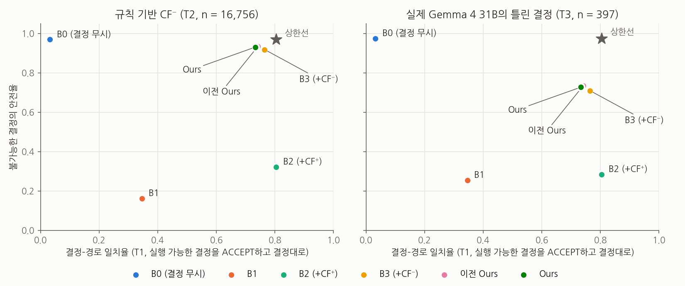
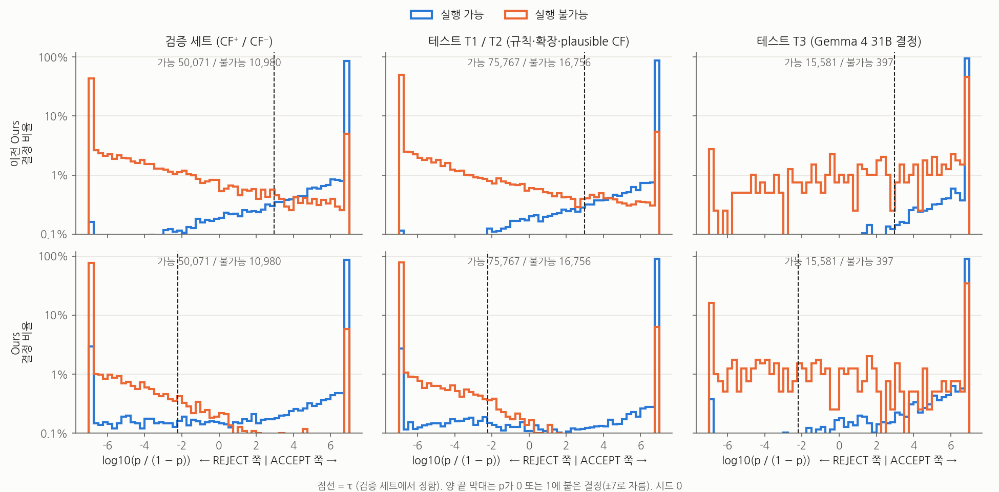
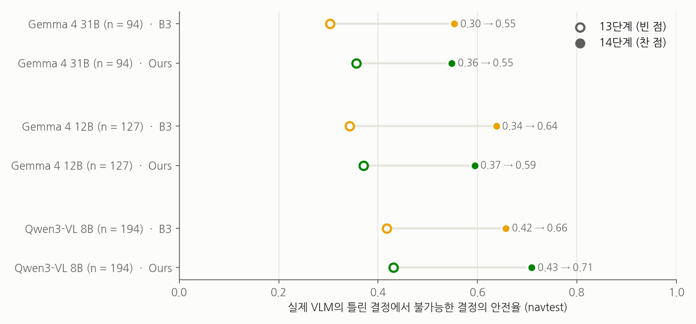
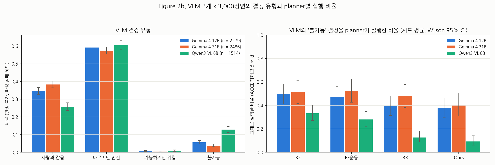
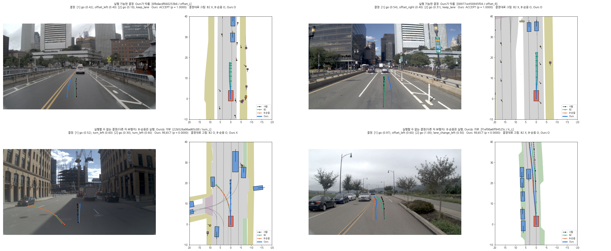

# YESMAN: Your Ego-planner Shouldn't Mindlessly Accept Nonsense

**VLM이 틀린 주행 결정을 내릴 때, 결정을 받는 planner는 어떻게 행동하는가**

2026년 10월 · acrodrive (14단계 결과 반영: 2026-10-17, 14단계 기여 분석: 2026-10-18, 14단계 사후 분석: 2026-10-20)



*Figure 1. 새 테스트 세트에서 결정–경로 일치율과 불가능한 결정의 안전율. 가로축은 실행할 수 있는 결정(T1)을 ACCEPT하고 결정대로 그린 비율, 세로축은 실행할 수 없는 결정을 받았을 때 그린 경로가 충돌·도로 이탈·역주행을 모두 피한 비율이다. 왼쪽은 규칙으로 만든 실행 불가능한 결정(T2), 오른쪽은 실제 VLM(Gemma 4 31B)이 낸 실행 불가능한 결정(T3)이다. 오른쪽 위가 바람직하다. 별은 상한선(결정 따르기는 B2, 안전은 결정을 무시하는 B0). 이전 Ours와 Ours는 거의 같은 자리라 점이 겹친다. 시드 2개의 평균이다.*

## 요약

VLM이 주행 결정을 내리고 planner가 그 결정을 받아 경로를 그리는 구조가 늘고 있다. 이 연구는 VLM의 결정이 틀렸을 때, 즉 그 장면에서 결정대로 움직이면 사고가 나는 결정을 받았을 때 planner가 어떻게 행동하는지를 NAVSIM에서 같은 조건으로 측정하였다. 실행할 수 없는 결정과 그 이유는 지도와 NAVSIM 채점 도구로 자동으로 만들었다. planner는 같은 고정 인코더(LTF)와 같은 diffusion 디코더 위에 구성 요소를 하나씩 더해 가는 사다리로 비교하였다.

연구는 두 번에 걸쳐 진행되었다. 13단계까지는 navtest에서 측정과 탐색을 하였고, 그 결과를 보며 설계를 바꾸었으므로 navtest는 개발 세트가 되었다. 14단계에서는 받지 않았던 navtrain 카메라 조각으로 새 테스트 세트를 만들었다. 학습 데이터와 CF를 늘리고 판단 구조를 바꾼 뒤, 고르는 규칙과 성공 기준을 결과를 보기 전에 고정하고(사전 등록) 새 테스트 세트에서 한 번만 평가하였다.

**주요 결과 (새 테스트 세트, 사전 등록한 비교, 시드 2개 평균)**

1. **실행할 수 없는 결정의 예(CF⁻)로 학습하면, 처음 보는 VLM의 틀린 결정에서도 크게 안전해진다.** Gemma 4 31B가 낸 실행 불가능한 결정 397개에서, 실행 가능한 결정만 배운 B2의 안전율은 28.5%, CF⁻까지 배운 B3는 70.9%, Ours는 72.7%이다(Ours − B2 = +44.2%p [+39.4, +48.7]).
2. **데이터와 CF를 늘리자 같은 세트에서도 안전율이 올랐고, 결정을 따르는 능력은 떨어지지 않았다.** navtest(개발 세트)에서 Gemma 4 31B 오답의 안전율이 13단계 B3 30% → 14단계 55%, 13단계 Ours 36% → 55%로 올랐다. 다른 두 VLM에서도 같은 방향이다(Figure 2). 결정–경로 일치율은 함께 올랐고(B3 65.7% → 68.1%, Ours 63.2% → 64.5%), 주행 점수는 떨어지지 않았다(B3 0.862 → 0.868, Ours 0.862 → 0.862). 기여 분석(탐색)에서 향상의 대부분은 **14단계에 더한 확장·plausible CF가 좌우 행동 말고 다른 종류의 결정 변화(앞뒤 행동, 강도, 여러 가지를 함께 바꾼 결정)를 CF⁻로 채운 것**에서 왔다. 실제 VLM의 실행 불가능한 결정에는 좌우 행동만 바꾼 결정이 하나도 없는데, 13단계 CF⁻는 90%가 그런 결정이었다. 이 CF⁻만 빼면 세 VLM 오답의 안전율이 59.5% → 45.1%로 13단계(38.1%) 가까이 돌아갔다. 기존 메뉴 CF⁻만으로 그런 종류의 무게 비율을 같게 올리면 차이의 약 40%만 메워졌으므로, 비율과 함께 확장·plausible CF⁻의 내용이 필요하다. CF⁻의 개수, batch 구성, 그럴싸함 강조는 거의 영향이 없었다(4.2절).
3. **판단을 DiT 안에서 읽는 새 Ours는 안전에서 B3보다 낮지 않고, 판단과 경로의 불일치를 줄이지만, 실행할 수 있는 결정을 덜 따른다.** 안전율 +1.8%p [−1.0, +4.5](기준 −5%p, 성공), flag–경로 불일치 이전 Ours 대비 −1.1%p [−1.3, −1.0](성공), 결정–경로 일치율 B3 대비 −3.2%p [−3.4, −3.0](기준 −2%p, **실패**). 판단을 따로 된 head에서 읽는 이전 Ours와 비교한 개선은 작다. 사후 분석에서 일치율 하락은 판단의 거부 때문이 아니라 모두 경로가 덜 따른 몫이었고, 더 센 CF⁻ 무게와 판단을 DiT와 함께 학습한 것이 반씩이었다(3.6절).
4. **판단은 규칙 기반 오답은 잘 거르지만 실제 VLM 오답은 3분의 1만 거르고, 안전을 더하지 못한다.** Ours는 규칙 기반 CF⁻의 90%를 거부하지만 Gemma 4 31B의 실행 불가능한 결정은 37%만 거부한다. 사후 분석에서, 판단이 거부한 결정은 대부분 경로가 이미 피하던 결정이었고, 경로가 그대로 따른 결정은 판단도 7~18%만 거부했다. 경로를 보지 않는 이전 Ours도 같아서, 판단과 경로가 같은 입력과 같은 CF⁻로 배워 같은 결정에서 함께 속는 것으로 보인다(3.5절). 실행 불가능한 결정의 52%는 강도 기준 오답이고, 주로 달리는 앞차를 20~50 m 뒤에서 따라가며 "더 빨리"를 고른 결정이다. 그 기준에서 안전율이 가장 낮다(69%). 결정을 무시하는 B0의 안전율(97.5%)과는 아직 차이가 크다.

**개발 과정에서 얻은 것 (13단계까지와 14단계 검증 세트. 일부는 사후 탐색이다)**

5. 결정을 더 잘 따르게 학습해도 실행할 수 없는 결정을 더 따르지는 않았다(13단계 사전 가설 기각). 다만 안전해지지도 않았다. 결정을 반만 실행하다 사고가 나는 경우가 많았다(5.1절).
6. 규칙 기반 CF⁻에서 잰 효과는 실제 VLM 오답에서 절반 이하로 줄었다. 실제 VLM 오답은 보면 바로 틀린 결정이 아니라 그럴싸하지만 움직임 때문에 틀리는 결정이다(5.2절). VLM을 쓰지 않고 그럴싸한 오답(plausible CF⁻)을 만들어 학습하면 학습에 쓰지 않은 VLM의 오답에서도 안전해졌다(5.4절).
7. 판단 head를 경로와 따로 두면, head가 "따른다"고 확신한 결정을 DiT가 따르지 않는 경우가 32%였다. 판단을 DiT가 경로를 만드는 표현에서 읽으면 처음 보는 VLM의 오답을 더 잘 갈랐다(5.6절). 이것이 새 Ours의 설계 근거이다.
8. 14단계 검증 세트에서는 학습 장면이 늘수록 결정–경로 일치율이 꾸준히 올랐고, 불가능한 결정의 안전율은 장면을 전부 넣었을 때 뚜렷하게 올랐다(4.3절). DiT의 마지막 층보다 중간 층에서 판단을 읽을 때 경로도 함께 좋아졌다.

## 1. 문제

VLM은 영상을 말로 이해하고 판단하므로 드문 상황에 강하고 설명할 수 있다. 그러나 VLM은 틀릴 수 있다. 좌회전 차로가 없는 곳에서 좌회전하라고 하거나, 앞차가 가까운데 속도를 높이라고 할 수 있다. 이때 결정을 받는 planner에게는 세 가지 길이 있다.

1. 결정을 그대로 따른다(맹목적인 추종). 도로를 벗어나거나 부딪힌다.
2. 알리지 않고 결정과 다르게 그린다(flag–경로 불일치). 옳은 결정이 들어왔을 때에도 따를지 알 수 없게 된다.
3. 결정을 거부하고, 거부했다고 밝히고, 장면에 맞게 주행한다.

planner가 VLM의 결정을 더 잘 따르도록 만드는 연구 흐름이 있다. 예를 들어 Senna-2(arXiv:2603.11219)는 VLM의 결정과 planner 경로에서 다시 읽은 결정의 일치(F1)를 여러 단계의 학습으로 높이며, 틀린 결정을 거부하거나 알리는 장치는 두지 않는다. 그래서 "결정을 잘 따르도록 학습할수록 틀린 결정도 더 따르는가"를 측정하는 것이 이 연구의 출발점이었다. 이어서 "틀린 결정을 거부하면서도 옳은 결정은 따르게 만들 수 있는가"를 물었다.

## 2. 방법

### 2.1. 결정 형식

4초 경로를 0~2초, 2~4초의 두 구간으로 나누고, 구간마다 앞뒤 행동(go / stop)과 좌우 행동(keep lane, offset 좌우, 차로 변경 좌우, 회전 좌우), 그리고 각각의 강도(0~1)를 정한다. 강도는 경로에서 계산할 수 있는 값이다.

| 행동 | 강도의 뜻 |
| --- | --- |
| go | 구간 끝 속도 ÷ 10.5 m/s (속도 수준) |
| stop | 구간 동안의 속도 감소량 ÷ 2.8 m/s |
| 회전 | 구간 동안의 방향 변화 ÷ 45° |
| offset | 옆 이동 거리 ÷ 1.7 m |
| 차로 변경 | 최대 옆 속도 ÷ 2.0 m/s |

### 2.2. 라벨: L1, L2, L3

- **L1 (경로 → 결정)**: 지도의 차로 중심선을 기준으로 경로를 진행 거리와 옆 거리로 바꾸고, 규칙으로 결정을 읽는다. 좌우 라벨은 상태가 아니라 전이이다(예: offset_L = 왼쪽으로 붙은 뒤 유지). 라벨을 만들 때와 모델을 평가할 때 같은 함수를 쓴다.
- **L2 (실행 가능 판정)**: navtrain의 사람 경로 모음에서 그 결정에 해당하는 경로를 골라 판정할 장면의 차로 위에 다시 그리고, NAVSIM v2 채점 도구로 채점한다. 충돌, 도로 이탈, 역주행을 모두 통과하는 후보가 하나라도 있으면 실행 가능, 하나도 없으면 실행할 수 없음, 후보가 5개 미만이면 판정 불가이다. 판정할 장면과 같은 로그의 경로는 후보에서 뺀다. 지도와 다른 차의 미래 움직임은 판정에만 쓰고 모델 입력에는 넣지 않는다.
- **L3 (counterfactual decision, CF)**: 사람의 원래 결정을 일부러 바꾼 결정을 L2로 판정한다. 실행할 수 있으면 CF⁺, 없으면 CF⁻이다. CF⁻는 실패 이유에 따라 도로 모양 / 다른 차·보행자 / 강도 기준으로 나누고, 원인 차량이 카메라 시야 밖이면 따로 표시한다(이런 CF⁻는 학습과 주 결과에서 뺀다). CF는 세 가지로 만든다.
  - **규칙 기반 CF**: 정해진 메뉴로 한 번에 한 가지를 바꾼다(좌우 행동 바꾸기, 속도 ±0.3, 정지 등, 장면마다 최대 12개).
  - **확장된 규칙 기반 CF**: 앞뒤와 좌우를 동시에 바꾸거나 좌우 강도·속도를 무작위로 정한다(장면마다 4개).
  - **plausible CF**: VLM을 쓰지 않고 그럴싸한 결정을 만든다. 다른 로그 중 내비게이션 명령이 같고 속도 차이가 2 m/s 이내인 장면에서 LTF 특징이 가장 비슷한 10개 장면의 사람 결정, 그리고 같은 로그의 약 1.5초 전 사람 결정을 지금 장면에 붙인다.
- **target 경로**(학습 때 모델이 그려야 하는 경로): 원래 결정과 CF⁻에는 사람의 실제 경로를 준다. CF⁺에는 그 장면 사람 경로에서 결정이 바꾸라는 부분(속도 또는 옆 거리)만 고친 경로를 준다. 고친 경로가 결정과 맞지 않거나 안전 확인을 통과하지 못하면, L2를 통과한 다른 장면의 사람 경로 중 이 장면 사람 경로와 가장 가까운 것을 쓴다(14단계 학습 묶음에서 46%).

### 2.3. 데이터와 세트

navtrain 카메라 데이터 32조각을 용도별로 나누었다. 조각은 로그 순서로 나뉘어 있으므로 도시가 치우치지 않도록 번호를 고르게 섞었다.

| 용도 | 조각 | 장면 |
| --- | --- | --- |
| 학습 + 검증 (13단계까지) | 1, 5, 9, 13, 17, 21, 25, 29 | 23,388 |
| 학습 추가 (14단계) | 나머지 16조각 | 49,418 |
| **새 테스트 세트** | 3, 11, 19, 27 | 18,880 |
| 예비 (보지 않음) | 7, 15, 23, 31 | 11,602 |

검증 세트는 학습 + 검증 로그 중 88개(13단계 30개 + 학습 추가 로그의 10%)이다. 용도 사이에 겹치는 로그는 없다.

| 세트 | 결정 | 새 테스트 세트 (주 결과) | navtest (개발 세트) |
| --- | --- | --- | --- |
| 0 | 사람의 원래 결정 | T0: 18,219 | D0: 11,751 |
| 1 | CF⁺ (규칙 기반 메뉴 전부) | T1: 75,767 | D1: 48,577 |
| 2 | CF⁻ (규칙 기반 메뉴 전부) | T2: 18,485 (주 결과 16,756) | D2: 14,498 (주 결과 13,755) |
| 3 | 실제 VLM 결정 | T3: Gemma 4 31B, 18,219장면 (실행 불가능 397) | D3x: Gemma 4 12B, Gemma 4 31B, Qwen3-VL 8B, 각 3,000장면 |

새 테스트 세트는 만든 뒤 체크섬으로 고정하였고(2026-10-15), 모든 학습과 고르기가 끝난 뒤 한 번만 평가하였다(2026-10-17). VLM은 7단계와 같은 프롬프트, JSON 스키마, greedy 디코딩을 썼다. 14단계 모델은 실제 VLM 결정으로 학습하지 않으므로 세 VLM 모두 처음 보는 VLM이다.

### 2.4. planner (모두 같은 고정 인코더와 같은 디코더)

- 인코더: NAVSIM 공식 LTF(Latent TransFuser) 체크포인트, 고정. 전방 카메라 3대, 차량 상태, 내비게이션 명령에서 장면 토큰을 한 번 뽑아 저장한다.
- 디코더: 4층 트랜스포머 diffusion 디코더(DiT, x0 예측, DDIM 10단계, 450만 파라미터). 결정은 구간마다 토큰 하나로 바꾸어 cross-attention으로 넣는다.

비교 모델은 구성 요소를 하나씩 더해 가는 사다리이다. 13단계까지의 이름과 코드 실행 이름은 부록 C에 있다.

| 모델 | 결정 입력 | 학습 샘플 | 판단 | 더한 것 |
| --- | --- | --- | --- | --- |
| B0 | ✕ | 원래 결정 | ✕ | 비교 기준. 결정을 쓰지 않는 planner |
| B1 | ○ | 원래 결정 | ✕ | 결정 입력 |
| B2 | ○ | + CF⁺ | ✕ | 실행 가능한 결정을 따르는 법 |
| B3 | ○ | + CF⁻ | ✕ | 실행 불가능한 결정을 피하는 법 |
| **Ours (주 모델)** | ○ | + CF⁻ | DiT 내부 표현에서 읽음 | 거부 표시. 판단과 경로가 같은 표현에서 나옴 |
| 이전 Ours (ablation) | ○ | + CF⁻ | DiT와 병렬인 head | 판단을 읽는 위치만 Ours와 다름 |

- **Ours의 판단**: DiT를 한 번 돌리고, 노이즈를 걷어 내는 마지막 단계에서 DiT 2층(중간 층)의 waypoint 은닉 상태를 head로 열어 판단(ACCEPT / REJECT)과 사유(충돌 / 도로 이탈 / 역주행)를 읽는다. 최종 경로는 그 DiT의 출력이다. 판단 손실은 노이즈가 적은 단계(t < 100)의 표현에서 계산하고, DiT와 함께 학습한다. 정답은 L2 판정이다.
- **이전 Ours**: 13단계까지의 Ours이다. 장면 토큰과 결정 토큰만 보는 별도 디코더에서 판단하므로, DiT가 그리는 경로를 보지 못한다.
- **판단 기준값 τ**: 검증 세트에서 실행할 수 있는 결정의 거부 비율이 5% 이하가 되는 값이다.

### 2.5. 학습과 고르는 절차 (사전 등록)

모든 모델은 시드 0과 1로 학습하였다. 아래 고르기는 모두 검증 세트에서 시드 0으로 하였고, 규칙은 결과를 보기 전에 `docs/step14_preregistration.md`에 고정하였다. 고정할 때 사전 등록에 비어 있던 몇 곳(고르는 데 쓴 기본 구성, 노이즈 투표의 m을 고르지 못할 때)은 결과를 보기 전에 정해 `docs/step14_run.md`에 기록하였다.

1. **양 늘리기 (고르지 않음)**: 학습 장면마다 규칙 기반 CF 메뉴 전부, 확장된 규칙 기반 CF 4개, plausible CF를 판정하고, 학습 추가 16조각을 넣었다. 학습 묶음은 593,257행(장면 62,972, CF⁺ 428,639, CF⁻ 101,646)이다. 강도 기준 CF⁻는 13단계 학습 묶음의 452개에서 10,213개로 늘었다.
2. **학습 step 수와 크기**: B3로 2만 / 4만 / 8만 / 12만 step을 비교해 **8만 step**을 골랐다(평균이 가장 좋은 후보와 0.01 이내인 것 중 가장 짧은 것). 층 6, 폭 384는 0.01 넘게 좋지 않아 **지금 크기**를 썼다.
3. **CF 학습 구성 (B3와 Ours 각자)**: plausible CF⁻ 비중(0.4 / 0.6 / 0.85)을 고르고, 강도 기준 무게, 결정 종류별 가능/불가능 균형, plausibility 가중치를 하나씩 켜 보아 점수가 오르면 켠 채로 두고, 마지막으로 CF⁻ 무게(CF⁺ 대비 0.25 / 0.5 / 1)를 고른다. 점수는 상한선에 얼마나 가까운가이다.

   ```
   점수 = ½ × (결정–경로 일치율 / B2의 결정–경로 일치율) + ½ × (불가능한 결정의 안전율 / B0의 불가능한 결정의 안전율)
   ```

4. **Ours 설정**: 판단을 읽는 층(마지막 / 2층)과 학습 방식(함께 / DiT를 먼저 학습해 고정)은 판단의 질을 재는 결정 종류 안 AUC로 고르되, 위 점수가 기본 설정보다 0.01 넘게 떨어지는 후보는 뺐다. 노이즈 10개로 투표하는 m은 실행 가능한 결정의 거부가 5% 이하인 것 중 안전율이 가장 높은 것을 고르기로 하였다.
5. **이전 Ours**는 구성을 따로 고르지 않고 Ours가 고른 구성으로 학습하였다.

| 모델 | 고른 구성 | 검증 세트: 일치율 / 안전율 / 점수 |
| --- | --- | --- |
| B3 | plausible 비중 0.4 + 강도 기준 무게 + CF⁻ 무게 0.5 | 0.700 / 0.897 / 0.938 |
| Ours | plausible 비중 0.4 + CF⁻ 무게 1, **2층**에서 판단, **함께 학습** | 0.667 / 0.909 / 0.923 (결정 종류 안 AUC 0.866) |
| 노이즈 투표 | m = 1 / 2 / 3 / 5 모두 거부가 5%를 넘어(최소 5.05%) **고르지 않음**. 테스트에서 빼고 검증 결과만 보고 | |

### 2.6. 지표와 미리 정한 비교

- **결정–경로 일치율**: 실행할 수 있는 결정을 ACCEPT하고 d̂ ≈ d인 비율(d̂ = L1(그린 경로), 구간마다 행동 종류가 같고 강도 차이 ±0.2). 판단 모델에서는 과잉 거부도 이 값을 낮춘다.
- **불가능한 결정의 안전율**: 실행할 수 없는 결정을 받았을 때 그린 경로가 충돌, 도로 이탈, 역주행을 모두 통과한 비율. 결정을 따랐는지와 상관없이 결과를 본다.
- **flag–경로 불일치율**: ACCEPT인데 경로가 결정을 따르지 않았거나, REJECT인데 경로가 결정을 따른 비율(T1 ∪ T2).
- **결정 종류 안 AUC**: 같은 결정 종류 안에서 실행 가능과 불가능을 판단 점수로 가르는 정도를 종류별로 내고 개수로 가중 평균한 값. 전체 AUC는 결정 종류의 사전 확률로 맞히는 몫이 섞여 부풀려진다.
- **주행 점수**: 사람 결정(T0)에서 NAVSIM 채점(테스트는 행마다 채점한 EPDMS, navtest는 공식 EPDMS).

미리 정한 비교는 같은 결정 위에서 시드 평균한 값의 짝지은 차이와 결정 단위로 5,000번 다시 뽑은 95% 구간으로 판정하였다. 구간 전체가 기준선의 성공 쪽이면 성공, 반대쪽이면 실패, 걸치면 결론 없음이다. 비교는 각각 따로 판정하고 여러 번 비교한 보정은 하지 않는다. 주 비교의 Ours는 노이즈 1개이다.

## 3. 주 결과: 새 테스트 세트 (한 번 평가, 시드 평균)

### 3.1. 미리 정한 비교

| 비교 | 지표 | Ours − 상대 [95% 구간] | 기준 | 판정 |
| --- | --- | --- | --- | --- |
| Ours vs B2 | 불가능한 결정의 안전율 (T3, n = 397) | **+44.2%p** [+39.4, +48.7] | 아래끝 > 0 | **성공** |
| Ours vs B3 | 불가능한 결정의 안전율 (T3, n = 397) | +1.8%p [−1.0, +4.5] | 아래끝 > −5%p | **성공** (낮지 않음) |
| Ours vs B3 | 결정–경로 일치율 (T1, n = 75,767) | −3.2%p [−3.4, −3.0] | 아래끝 > −2%p | **실패** |
| Ours vs 이전 Ours | flag–경로 불일치율 (T1 ∪ T2, n = 94,252) | −1.1%p [−1.3, −1.0] | 위끝 < 0 | **성공** |
| Ours vs 이전 Ours | 결정 종류 안 AUC (보조) | 0.821 대 0.855 | 값만 보고 | 이전 Ours가 높음 |

### 3.2. 모델별

| 모델 | T1 결정–경로 일치율 | 과잉 거부 (T0+T1) | T2 안전율 | **T3 안전율** | T0 주행 점수 | flag–경로 불일치 | 결정 종류 안 AUC |
| --- | --- | --- | --- | --- | --- | --- | --- |
| B0 (결정 무시) | 3.1% | 0 | 96.9% | 97.5% | 0.938 | – | – |
| B1 | 34.6% | 0 | 16.2% | 25.4% | 0.946 | – | – |
| B2 (+ CF⁺) | **80.5%** | 0 | 32.3% | 28.5% | 0.939 | – | – |
| B3 (+ CF⁻) | 76.5% | 0 | 91.8% | 70.9% | 0.939 | – | – |
| 이전 Ours | 74.1% | 4.1% | 93.3% | **73.4%** | 0.941 | 19.6% | **0.855** |
| **Ours** | 73.3% | 4.4% | 93.0% | 72.7% | 0.937 | **18.5%** | 0.821 |

- B2는 결정을 가장 잘 따르지만(80.5%) 처음 보는 VLM의 틀린 결정도 대부분 실행한다(T3 안전율 28.5%). 결정을 쓰지 않는 B0와 결정만 배운 B1 사이의 차이(97.5% → 25.4%)가 "결정을 입력으로 받는 순간 생기는 위험"이다.
- CF⁻를 배우면(B3) 그 위험의 대부분이 사라진다(28.5% → 70.9%). 대가는 결정–경로 일치율 4.0%p이고 주행 점수는 그대로이다.
- Ours와 이전 Ours는 B3에 거부 표시와 사유를 더한다. 안전율은 B3와 비슷하고, 결정–경로 일치율은 더 낮다. Ours에서는 낮아진 몫 전부가 경로가 결정을 덜 따른 몫이다. Ours가 거부한 실행 가능한 결정은 경로도 따르지 않은 결정이었다(3.6절).
- 사람의 원래 결정(T0)을 거부하는 비율은 Ours 0.1%, 이전 Ours 0.7%이다.

### 3.3. 불가능 이유별

| 안전율 | T2 도로 (8,846) | T2 다른 차 (6,377) | T2 강도 (1,533) | T3 도로 (69) | T3 다른 차 (122) | T3 강도 (206) |
| --- | --- | --- | --- | --- | --- | --- |
| B0 | 96% | 98% | 98% | 91% | 98% | 99% |
| B2 | 33% | 28% | 41% | 54% | 18% | 26% |
| B3 | 95% | 89% | 85% | 78% | 66% | **71%** |
| 이전 Ours | 96% | 92% | 83% | 83% | 77% | 68% |
| Ours | 95% | 92% | 83% | 84% | 73% | 69% |

| Ours의 거부율 | 사람 결정 (T0) | 규칙 기반 CF⁻ (T2) | Gemma 4 31B의 실행 불가능한 결정 (T3) |
| --- | --- | --- | --- |
| 이전 Ours | 0.7% | 89% | 35% |
| Ours | 0.1% | 90% | 37% |

- 실제 VLM의 실행 불가능한 결정은 절반 이상(206 / 397)이 강도 기준이다. 규칙으로 만든 CF⁻(T2)에서는 9%뿐이다.
- 판단은 규칙 기반 CF⁻의 90%를 거르지만 실제 VLM 오답은 3분의 1만 거른다. 실제 VLM 오답에서 안전율이 높은 것은 대부분 판단이 아니라 DiT가 결정을 피해 그린 경로 덕분이다.
- 강도 기준은 판단이 있는 모델에서도 가장 약하고, B3가 조금 높다.

### 3.4. 실제 VLM 결정의 구성 (T3, Gemma 4 31B, 18,219장면)

| | 실행 가능 | 실행할 수 없음 | 판정 불가 | 합계 |
| --- | --- | --- | --- | --- |
| 사람 결정과 같음 | 4,812 | 15 | 59 | 4,886 (26.8%) |
| 사람 결정과 다름 | **10,769 (59.1%)** | 382 | 2,182 | 13,333 |
| 합계 | 15,581 | **397 (2.2%)** | 2,241 (12.3%) | 18,219 |

VLM 오류의 대부분은 "실행할 수 있지만 사람과 다른" 결정이고, 실행할 수 없는 결정은 소수이지만 0이 아니다(navtest에서는 3.8%). 실행 불가능한 397개 중 15개는 사람 결정과 같은 결정이다. 판정 쪽이 너무 엄격했을 가능성이 있지만, 13단계와 달리 이번 주 지표에서는 빼지 않았다(사전 등록한 평가 코드 그대로).

### 3.5. 사후 분석: 판단은 무엇을 했나

3.5절과 3.6절은 테스트 결과를 한 번 평가한 뒤 다시 나눈 사후 분석이다. 모델과 τ는 바꾸지 않았다. 시드 2개의 평균이다. 자세한 표는 `docs/step14_run.md`의 "(사후 분석)" 절들과 `docs/step14_posthoc_*.md`에 있다.

실행할 수 없는 결정을 판단(ACCEPT / REJECT)과 경로(결정을 따름 / 안 따름)의 네 칸으로 나누었다. 괄호 안은 그 칸에서 그린 경로의 안전율이다.

| 모델 | 세트 | REJECT·안 따름 (바람직) | REJECT·따름 | ACCEPT·따름 (맹목적 추종) | ACCEPT·안 따름 (조용히 피함) |
| --- | --- | --- | --- | --- | --- |
| B3 | T3 | – | – | 23.9% (25.8%) | 76.1% (85.1%) |
| 이전 Ours | T3 | 30.4% (95.0%) | 4.4% (28.6%) | 19.0% (31.1%) | 46.2% (80.9%) |
| Ours | T3 | 35.4% (97.5%) | 1.1% (n = 4) | 23.0% (26.2%) | 40.4% (76.9%) |
| Ours | T2 | 89.6% (97.4%) | 0.1% (n = 18) | 3.6% (27.7%) | 6.7% (70.4%) |

- **판단은 맹목적 추종을 거의 줄이지 못한다**(B3 23.9%, Ours 23.0%). Ours의 거부는 대부분 B3도 경로로 피하던 결정에 "거부"라는 이름을 붙인 것이다. 그래서 안전율이 B3와 같다.
- **T3에서 판단의 말은 어느 쪽으로도 믿기 어렵다.**
  - REJECT의 63%는 VLM이 맞게 낸 실행 가능한 결정이다(정밀도 37%). 판정된 결정 중 실행할 수 없는 결정이 2.5%로 드물어서, 실행 가능한 결정을 1.6%만 거부해도 이렇게 된다.
  - ACCEPT한 실행 불가능 결정의 64%는 경로가 결정을 따르지 않았다.
- **순위로도 덜 가른다.** 실행 가능과 불가능을 판단 점수로 가르는 AUC가 T1∪T2의 0.95에서 T3의 0.80으로 떨어진다. τ를 옮겨서 풀리는 문제가 아니다. T3 실행 불가능 결정의 3분의 1은 p가 float32에서 정확히 1이라, 어떤 τ로도 거부할 수 없다(Figure 4).
- **떨어지는 이유의 절반은 결정 종류의 구성이다.**
  - 판단이 93%를 거부하는 "좌우만 바꾼" 결정이 T2의 87%인데, T3에는 하나도 없다. T2의 종류별 거부율을 T3의 구성으로 다시 가중하면 거부율은 90%에서 64%가 된다.
  - 나머지 절반은 같은 종류 안에서도 덜 거부하기 때문이다(앞뒤 67% → 31%, 좌우 + 강도 86% → 51%).



*Figure 4. 판단 점수 p의 분포(시드 0). 가로축은 log10(p / (1 − p))이고 오른쪽이 ACCEPT 쪽, 점선이 τ이다. 양 끝 막대는 p가 0 또는 1에 붙은 결정이다. 검증 세트와 T1/T2에서는 실행 불가능한 결정(주황)이 왼쪽 끝에 몰리지만, T3에서는 넓게 퍼지고 상당수가 오른쪽 끝(p = 1)에 있다.*

**판단은 경로 생성기가 속는 결정을 함께 놓친다.** T3 실행 불가능 결정을, 같은 시드의 B3 경로가 그대로 따랐는지로 나누어 판단의 거부율을 보았다.

| 판단의 거부율 (시드 0, 1 평균) | B3 경로가 따른 결정 (약 95개) | B3 경로가 피한 결정 (약 300개) |
| --- | --- | --- |
| 이전 Ours (경로를 보지 않음) | 17% | 40% |
| Ours (DiT 2층에서 읽음) | 10% | 45% |

- 판단이 가장 필요한 결정은 경로 생성기가 속는 결정이다. 그런데 판단도 거기서 함께 속는다.
- 경로를 보지 않는 이전 Ours도 같으므로, 원인은 판단을 DiT 안에서 읽는 구조가 아니다. 판단과 경로 생성기는 같은 입력(고정된 LTF 장면 특징과 결정)과 같은 CF⁻ 라벨로 배운다. 그래서 같은 결정에서 막히는 것으로 보인다.
- 입력 정보와 학습 데이터 중 무엇이 원인인지는 navtest에서 따로 보았다(4.4절).

### 3.6. 사후 분석: 강도 기준과 결정–경로 일치율

**강도 기준.** T3 강도 기준 결정 206개 중 79%는 사람보다 빨리 가라는 결정이다.
- 실패는 거의 모두 앞차와의 충돌이다(Ours 충돌 30.3%, 도로 이탈 1.7%).
- Ours가 안전하지 못했던 경우의 77%는 ACCEPT하고 결정대로 그린 경우이다.
- B3도 같은 모양이라(충돌 27.2%) 판단만의 문제가 아니다.

앞차는 정답 어노테이션으로 나누었다(분석에만 씀).

| T3 강도 기준, Ours 안전율 (결정 수) | 낮은 쪽 | 높은 쪽 |
| --- | --- | --- |
| 앞차 거리 | 20~50 m: **61%** (97) | 10~20 m: 76% (93) |
| ego 속도 | 5~10 m/s: **65%** (114) | 1~5 m/s: 80% (74) |

- **Gemma 4 31B의 강도 오답은 어려운 조건에 몰려 있다.** 앞차가 달리는 경우가 52%, 앞차가 20~50 m 떨어진 경우가 47%, ego가 5~10 m/s로 달리는 경우가 55%이다. 규칙으로 만든 T2에서는 각각 29%, 14%, 17%이다.
- 이런 조건에서 "더 빨리"가 되는지는 앞차와의 거리가 얼마나 빨리 줄어드는지에 달려 있다.
- T2의 조건별 안전율을 그대로 두고 조건 구성만 T3처럼 바꾸면, Ours의 안전율은 82.7%에서 73.1%가 된다(실제 T3는 68.9%). T2 → T3 하락의 약 70%가 조건 구성으로 설명된다.
- 실행할 수 있는 "더 빨리"(T1)도 덜 따른다. Ours의 결정–경로 일치율이 "더 빨리" 67%, "더 천천히" 91%, 정지 98%이다. 곧 모델은 "더 빨리"가 되는지를 잘 가르지 못한다.
- 현재 프레임 하나만 보는 인코더로는 앞차 속도를 알기 어렵다는 해석과 맞지만, 확인한 것은 아니다.

**결정–경로 일치율 (3.1절의 실패).** 일치율을 두 몫으로 나누었다. 경로 몫은 경로가 결정을 따른 비율이고, 판단 몫은 경로는 따랐는데 판단이 거부한 비율이다.
- **판단 몫은 0이다.** T1에서 Ours − B3 = −3.2%p는 경로 몫 −3.2%p, 판단 몫 0.0%p이다. Ours가 거부한 실행 가능한 결정(5.4%)은 모두 경로도 따르지 않은 결정이다. 이전 Ours는 판단 몫이 1.2~1.8%p 있다.
- **경로 몫은 두 원인이 반씩이다.** 고르기 후보(시드 0, 검증 세트)로 단계별로 나누었다.
  - CF⁻ 무게 0.5 → 1: −1.8%p [−2.2, −1.5]
  - 판단을 DiT와 함께 학습: −1.3%p [−1.6, −0.9] (navtest에서는 −1.6%p)
  - 강도 기준 무게를 끄는 것과, DiT를 고정하고 판단 head만 붙이는 것은 영향이 없었다.
- **정리**: 판단을 DiT 안에서 함께 학습하면 판단의 질은 얻지만(결정 종류 안 AUC, 검증 세트 0.866 대 0.843), 경로가 결정을 조금 덜 따른다. 실제 VLM 오답에서는 판단이 안전을 더하지 못했으므로(3.5절), 이 대가에 비해 얻은 것이 작다.

## 4. 개발 세트와 고르기

### 4.1. 같은 세트(navtest)에서 13단계 → 14단계 (탐색)

테스트 평가가 끝난 뒤 14단계 최종 모델을 navtest에서 평가하였다. 13단계 모델은 navtest를 보며 고친 모델이고 14단계 모델은 navtest를 한 번도 보지 않았으므로, 비교 조건은 13단계에 유리하다.



*Figure 2. navtest에서 실제 VLM 3개의 실행 불가능한 결정에 대한 안전율. 빈 점은 13단계 모델, 찬 점은 14단계 모델이다. Ours 줄의 13단계 값은 13단계의 Ours(이 보고서의 이전 Ours 구조, 13단계 구성)이다.*

| 모델 | D1 결정–경로 일치율 | D2 안전율 | D2 강도 기준 | Gemma 4 31B (94) | Gemma 4 12B (127) | Qwen3-VL 8B (194) | D0 EPDMS |
| --- | --- | --- | --- | --- | --- | --- | --- |
| 13단계 B3 | 65.7% | 76.9% | 51.3% | 30.3% | 34.3% | 41.8% | 0.862 |
| 13단계 Ours | 63.2% | 77.2% | 52.0% | 35.6% | 37.0% | 43.0% | 0.862 |
| 14단계 B0 (결정 무시) | 4.5% | 87.2% | 85.2% | 72.9% | 77.2% | 79.1% | 0.855 |
| 14단계 B3 | **68.1%** | 82.6% | **75.6%** | **55.3%** | **63.8%** | 65.7% | 0.868 |
| 14단계 Ours | 64.5% | **84.3%** | 73.8% | 54.8% | 59.4% | **70.9%** | 0.862 |

- 같은 세트에서 처음 보는 VLM의 틀린 결정에서의 안전율이 크게 올랐다(Gemma 4 31B: B3 +25%p, Ours +19%p). 약점이던 강도 기준(D2)도 51% → 74~76%이다.
- 결정–경로 일치율은 함께 올랐고(B3 +2.4%p, Ours +1.3%p), 주행 점수는 떨어지지 않았다(B3 0.862 → 0.868, Ours는 같음).
- 장면 수, CF의 양과 종류, step 수가 함께 바뀌었다. 무엇이 기여했는지는 4.2절에서 나눈다.
- navtest의 Gemma 4 31B 불가능 결정은 94개라 구간이 넓다(±10%p쯤). 테스트 T3(397개)에서 값이 더 높은 것(71~73%)은 세트 차이로 본다.

### 4.2. 무엇이 안전율을 올렸나 (기여 분석, 탐색)

4.1절의 향상을 나누기 위해, 검증 세트로 고를 때 학습해 둔 후보 모델을 navtest에서 평가하고, 학습 묶음의 일부를 뺀 B3를 새로 학습하였다. 모두 B3, 시드 0이고, 새로 학습한 모델은 기본 구성(8만 step, CF⁻ 무게 0.25, plausible 비중 0.6)이다. 안전율은 세 VLM(D3x)의 실행 불가능한 결정 415개를 합쳐 계산하였고, 구간은 같은 결정끼리 짝지은 부트스트랩 95% 구간이다. 테스트 세트는 쓰지 않았다.

**학습 묶음의 CF 유형.** 유형은 원래 결정에서 바꾼 것(좌우 행동, 앞뒤 행동, 강도와 그 조합)이다. 보이지 않는 원인 CF⁻는 학습에 쓰지 않으므로 뺐다. 학습 장면은 13단계 20,238개, 14단계 62,972개이다.

| CF⁻ (실행할 수 없음): 바꾼 것 | 13단계 | 14단계 메뉴 | 14단계 확장 | 14단계 plausible | 14단계 합계 |
| --- | --- | --- | --- | --- | --- |
| 좌우 | 6,943 | 58,965 | 6,175 | 26 | 65,166 |
| 강도 | 223 | 1,985 | 1,776 | 944 | 4,705 |
| 앞뒤 | 125 | 1,135 | 770 | 782 | 2,687 |
| 좌우 + 강도 | 309 | 2,714 | 8,446 | 2,752 | 13,912 |
| 앞뒤 + 강도 | 124 | 1,200 | 941 | 619 | 2,760 |
| 좌우 + 앞뒤 | 0 | 0 | 3,074 | 310 | 3,384 |
| 좌우 + 앞뒤 + 강도 | 0 | 0 | 1,894 | 310 | 2,204 |
| **합계** | **7,724** | **65,999** | **23,076** | **5,743** | **94,818** |
| 실패 이유: 도로 모양 / 다른 차·보행자 / 강도 기준 | 4,850 / 2,422 / 452 | 43,191 / 18,814 / 3,994 | 9,870 / 8,985 / 4,221 | 2,559 / 1,186 / 1,998 | 55,620 / 28,985 / 10,213 |

| CF⁺ (실행 가능): 바꾼 것 | 13단계 | 14단계 메뉴 | 14단계 확장 | 14단계 plausible | 14단계 합계 |
| --- | --- | --- | --- | --- | --- |
| 좌우 | 19,265 | 152,910 | 16,514 | 777 | 170,201 |
| 강도 | 8,171 | 64,844 | 19,605 | 40,330 | 124,779 |
| 앞뒤 | 3,086 | 24,822 | 955 | 5,940 | 31,717 |
| 좌우 + 강도 | 871 | 8,405 | 15,892 | 36,347 | 60,644 |
| 앞뒤 + 강도 | 1,046 | 8,335 | 2,298 | 18,302 | 28,935 |
| 좌우 + 앞뒤 | 0 | 0 | 6,472 | 854 | 7,326 |
| 좌우 + 앞뒤 + 강도 | 0 | 0 | 2,286 | 2,751 | 5,037 |
| **합계** | **32,439** | **259,316** | **64,022** | **105,301** | **428,639** |

규칙 기반 메뉴의 CF⁻는 13단계와 14단계 모두 약 90%가 좌우 행동만 바꾼 결정이다. 메뉴의 CF⁺에는 앞뒤 행동과 강도를 바꾼 결정이 많지만, 그런 결정은 대부분 실행할 수 있어서 CF⁻가 되는 경우가 드물다. 좌우와 앞뒤를 함께 바꾼 CF⁻는 확장 CF와 plausible CF에서만 나온다. 기본 구성(plausible 비중 0.6)에서는 CF⁻ 학습 무게의 60%가 plausible CF⁻ 5,743개에 간다.

**고르기 후보로 본 요소**

| 바꾼 것 | 안전율 | 차이 [95% 구간] |
| --- | --- | --- |
| 13단계 B3 → 기존 8조각만 쓴 14단계 B3 | 38.1% → 57.6% | +19.5%p [+14.9, +24.3] |
| 학습 장면 8조각 → 24조각 | 57.6% → 59.5% | +1.9%p [−2.7, +6.3] |
| 학습 step 2만 → 8만 | 58.3% → 59.5% | +1.2%p [−2.9, +5.3] |
| plausible 비중 0.6 → 0.4, 강도 기준 무게 켬 | 59.5% → 61.4% | +1.9%p [−1.2, +5.3] |
| CF⁻ 무게 0.25 → 0.5 (= 14단계 B3 최종) | 61.4% → 63.9% | +2.4%p [−1.2, +6.0] |
| (참고) 같은 구성을 따로 두 번 학습 | 60.2%, 59.5% | −0.7%p [−3.6, +2.2] |

13단계와 같은 장면 수로도 대부분이 오르므로 장면 수는 주된 원인이 아니고, step 수도 아니다. 하나씩 따로 보면 나머지 요소는 모두 1~2%p이다.

**학습 묶음에서 뺀 것** (기준: 14단계 기본 구성 B3, 59.5%)

| 학습 묶음 | CF⁻ 무게 중 좌우 행동만 바꾸지 않은 결정 | 안전율 (D3x) | 기준 대비 [95% 구간] | D2 안전율 (규칙 기반) |
| --- | --- | --- | --- | --- |
| 기준 (메뉴 + 확장 + plausible) | 70.5% | 59.5% | | 80.0% |
| CF⁻를 무작위로 26%만 (장면당 개수를 13단계 수준으로, 종류 구성은 그대로) | 70.5% | 58.6% | −1.0%p [−4.6, +2.7] | 79.4% |
| CF⁺를 무작위로 24%만 (batch 구성을 13단계와 같게) | 70.5% | 59.0% | −0.5%p [−4.1, +3.1] | 80.7% |
| 확장 CF 뺌 | 64.0% | 60.5% | +1.0%p [−2.4, +4.3] | 80.3% |
| plausible CF 뺌 | 26.9% | 54.9% | −4.6%p [−8.7, −0.7] | 81.7% |
| **확장·plausible의 CF⁻만 뺌** (CF⁺는 남김) | **10.7%** | **45.1%** | **−14.5%p [−18.8, −10.1]** | 82.4% |
| 확장·plausible 모두 뺌 (메뉴만) | 10.7% | 42.4% | −17.1%p [−21.7, −12.5] | 81.9% |
| (사후 분석) 메뉴만 쓰고, 좌우 행동만 바꾸지 않은 CF⁻의 무게를 70.5%로 | 70.5% | 49.6% | −9.9%p [−14.5, −5.3] | 81.0% |
| (참고) 13단계 B3 | 10.1% | 38.1% | | 77.2% |

무게 비율은 위 CF⁻ 표의 개수에 학습 코드의 무게 규칙(CF⁻ 안에서 plausible CF⁻에 plausible 비중만큼, 나머지에 개수대로)을 적용해 계산한 값이다. 무작위로 줄인 두 묶음은 종류 구성이 기준과 같으므로 기준과 같은 값으로 적었다.

**VLM 결정이 바꾼 것별 안전율**

| VLM 결정이 바꾼 것 | 결정 수 | 13단계 B3 | 14단계 기준 | 확장·plausible의 CF⁻만 뺌 |
| --- | --- | --- | --- | --- |
| 좌우 + 강도 | 200 | 63.0% | 68.5% | 62.5% |
| 강도 | 115 | 20.0% | 44.3% | 31.3% |
| 앞뒤 + 강도 | 32 | 0.0% | 40.6% | 31.2% |
| 앞뒤 | 31 | 12.9% | 80.6% | 25.8% |
| 좌우 + 앞뒤 | 19 | 5.3% | 57.9% | 21.1% |
| 좌우 + 앞뒤 + 강도 | 18 | 22.2% | 55.6% | 22.2% |

- **주된 원인은 학습용 CF⁻에 어떤 종류의 결정 변화가 들어 있는지이다.** 확장·plausible의 CF⁻만 빼도 안전율이 13단계 근처로 돌아간다(13단계 B3보다 +7.0%p [+2.7, +11.6]). 떨어지는 곳은 13단계 CF⁻에 거의 없던 종류(앞뒤 행동, 강도, 여러 가지를 함께 바꾼 결정)이다. 13단계 CF⁻에도 꽤 있던 "좌우 + 강도"는 거의 그대로이다. 실제 VLM의 실행 불가능한 결정 415개에는 좌우 행동만 바꾼 결정이 하나도 없는데, 13단계 CF⁻와 14단계 메뉴 CF⁻는 약 90%가 좌우 행동만 바꾼 결정이다. 모델은 CF⁻로 본 종류의 결정에서 결정대로 그리지 않는 것을 배우고, 보지 못한 종류에서는 그대로 따른다고 보인다.
- **개수나 batch 구성은 원인이 아니고, CF⁻ 무게 중 비율이 크게 작용한다.** 종류 구성을 그대로 두고 CF⁻를 4분의 1로 줄여도, CF⁺를 줄여 batch 구성을 13단계와 같게 맞춰도 안전율이 그대로이다. 반대로 메뉴만 쓴 모델에도 13단계 CF⁻에 거의 없던 종류(강도, 앞뒤, 앞뒤 + 강도)의 CF⁻가 4,320개 있어 13단계(472개)의 9배이지만, CF⁻ 무게 중 비율은 6.5%로 13단계(6.1%)와 같고, 안전율은 13단계보다 4.3%p [+0.2, +8.4]만 높다. 안전율은 표의 무게 비율을 따라간다. 비율이 약 10%인 묶음은 42~45%, 27%인 묶음은 54.9%, 64~71%인 묶음은 59~61%이다. 비율이 27%일 때 이미 향상의 약 4분의 3이 나타나고, 그 위로는 거의 오르지 않는다. 다만 비율만으로 다 설명되지는 않는다(아래 "비율과 내용").
- **그럴싸함은 원인으로 보이지 않는다.** 확장 CF는 규칙으로 만든 것이라 그럴싸함 점수가 메뉴와 비슷하게 낮다(평균 0.004, 메뉴 0.007, plausible 0.132). 그런데 메뉴에 확장 CF만 더한 모델(plausible 뺌, 54.9%)이 메뉴만 쓴 모델(42.4%)보다 12.5%p 높다. 이 짝의 구간은 아직 계산하지 않았다. plausible 비중을 0.4~0.85로 바꾸어도 차이가 없었다. 확장을 빼면 안전율이 그대로이지만(+1.0%p [−2.4, +4.3]) plausible을 빼면 떨어지는데(−4.6%p [−8.7, −0.7]), 이 차이도 무게 비율로 대부분 설명된다. 기준 구성은 CF⁻ 무게의 60%를 plausible CF⁻에 주고, plausible CF⁻는 99.5%가 좌우 행동만 바꾸지 않은 결정이다. 그래서 plausible을 빼면 비율이 70.5%에서 26.9%로 떨어지지만, 확장을 빼면 64.0%로 거의 그대로이다. plausible CF는 그럴싸해서가 아니라, 새 종류의 CF⁻를 큰 무게로 공급해서 도움이 된 것으로 보인다. 13단계에서 plausible CF⁻가 처음 보는 VLM에서 도움이 된 것(5.4절)도 같은 이유일 수 있다.
- **규칙 기반 평가로는 이 효과가 보이지 않는다.** D2(메뉴로 만든 CF⁻)에서는 메뉴 CF만 쓴 모델이 오히려 기준보다 높다(81.9% 대 80.0%). 검증 세트의 CF⁻도 대부분 메뉴이므로, 고르기 점수로도 이 효과를 볼 수 없었다(4.3절).
- **대략적인 나눔** (서로 정확히 더해지는 값이 아니라 어림이다): 13단계 B3 38.1% → 14단계 B3 최종 63.9%(+25.8%p) 가운데 새 종류의 CF⁻가 약 15%p, 그 밖의 데이터와 학습 변화(장면 3배, 8만 step, 메뉴 CF의 양, CF⁺)가 약 7%p, 최종 구성(plausible 비중 0.4, 강도 기준 무게, CF⁻ 무게 0.5)이 약 4%p이다.
- **비율과 내용 (사후 분석)**: 메뉴 CF만 쓰되 좌우 행동만 바꾸지 않은 CF⁻의 무게를 기준과 같은 70.5%로 올린 B3를 학습하였다.
  - 안전율이 42.4%에서 49.6%로 올랐다(+7.2%p [+3.4, +11.3]). 기준과의 차이 17.1%p 중 약 40%만 메워진다. 남은 −9.9%p는 확장·plausible CF⁻의 내용이 있어야 메워진다. **둘 다 작용하고, 내용 쪽이 조금 더 크다.**
  - 메뉴에 많은 "좌우 + 강도"는 비율만 올려도 기준과 같아졌다(69.0% 대 68.5%).
  - 메뉴에 없는 "좌우 + 앞뒤"는 오르지 않았다. 메뉴에도 1,135개 있는 "앞뒤"도 오르지 않았다(29.0% 대 80.6%). 확장·plausible의 앞뒤 CF⁻는 메뉴와 다른 상황을 덮는 것으로 보인다(해석).
- **한계**: 시드 하나, B3만으로 보았다(Ours는 CF⁻ 무게만 보았고 B3와 같은 방향: 0.25 → 1에서 +7.0%p [+2.7, +11.3]). 바뀐 것별 결정 수가 18~200개라 작다. navtest는 개발 세트이다.

### 4.3. 검증 세트로 본 것

**학습 step 수와 장면 수 (B3, 기본 구성)**

| 학습 step | 2만 | 4만 | **8만** | 12만 |
| --- | --- | --- | --- | --- |
| 일치율 / 안전율 | 0.657 / 0.835 | 0.691 / 0.849 | 0.721 / 0.859 | 0.732 / 0.867 |

| 학습 장면 | 기존 8조각 | + 4조각 | + 8조각 | + 16조각 (전부) |
| --- | --- | --- | --- | --- |
| 일치율 / 안전율 | 0.696 / 0.847 | 0.707 / 0.844 | 0.711 / 0.847 | 0.721 / 0.859 |

13단계까지 쓰던 2만 step은 데이터가 3배가 된 지금은 짧다. 장면 수는 늘릴수록 일치율이 꾸준히 오르고, 안전율은 전부 넣었을 때 뚜렷하게 오른다(장면 수 단계는 보고만 하고 고르는 데 쓰지 않았다).

**CF 학습 구성**: plausible 비중을 올리면 일치율은 조금 오르고 안전율은 떨어졌다(B3: 0.4 / 0.6 / 0.85에서 안전율 0.874 / 0.858 / 0.821). CF⁻ 무게를 올리면 안전율이 오르고 일치율이 떨어졌다. 두 모델 모두 비중 0.4가 골라졌고, 장치 세 개 중에서는 B3의 강도 기준 무게만 켜졌다(점수 차이 0.0006).

**Ours 설정**: 마지막 층에서 판단을 읽을 때의 AUC(0.865)가 이전 Ours(0.868)보다 낮아 2층 후보를 학습하였고, 2층이 골라졌다(AUC 0.866). 2층은 경로도 좋아졌다(일치율 0.620 → 0.667, 안전율 0.890 → 0.909). 마지막 층에서 판단 손실을 받으면 경로를 내는 마지막 표현이 판단 쪽으로 끌려가는 것으로 보인다(해석). DiT를 고정하고 head만 학습하면 경로는 조금 낫지만(점수 0.932) 판단이 떨어져(AUC 0.843) 함께 학습이 골라졌다.

**노이즈 투표**: 노이즈마다 판단이 조금씩 달라 투표하면 거부가 늘었다. 그래서 τ를 노이즈 1개 기준으로 정한 상태에서는 어떤 m도 거부 5%를 지키지 못했다.

| m (K = 10) | 1 | 2 | 3 | 5 |
| --- | --- | --- | --- | --- |
| 과잉 거부 | 9.2% | 7.4% | 6.4% | 5.05% |
| 안전율 | 0.924 | 0.920 | 0.916 | 0.909 |

**(탐색) CF 출처별 안전율**: 고르기의 안전율은 CF⁻ 전체 평균이라, 95%를 차지하는 규칙 기반 CF⁻가 값을 정한다. 출처별로 나누면 plausible CF⁻(532개)는 모든 모델에서 규칙 기반보다 약 15%p 덜 안전하다(최종 B3 0.739, 이전 Ours 0.750, Ours 0.773, 결정을 무시하는 B0 0.876). plausible 비중을 올려도 plausible CF⁻에서의 안전율은 오르지 않았고(B3 0.752 / 0.750 / 0.737), 학습 장면을 늘리면 크게 올랐다(0.643 → 0.746).

### 4.4. 판단이 어려운 결정을 못 잡는 이유: 입력 정보인가, 학습 데이터인가 (사후 탐색)

3.5절에서 판단은 경로 생성기가 속는 결정을 함께 놓쳤다. 13단계에는 정답 물체 위치·속도를 입력으로 더해 학습한 모델(5.5절)이 있다. 그래서 navtest D3x에서, 같은 기준의 "어려운 결정"을 이 모델들이 더 거부하는지 보았다. 어려운 결정은 13단계 B3가 그대로 따른 실행 불가능 결정이다. 새로 학습한 모델은 없다. 모두 13단계의 이전 Ours 구조이고, 시드 2개의 평균이다.

| 판단의 거부율 | 어려운 결정, 세 VLM (120) | 어려운 결정, 학습에 안 쓴 Gemma 4 31B (45) | 쉬운 결정, 세 VLM (296) |
| --- | --- | --- | --- |
| 기본 | 14.1% | 13.3% | 66.9% |
| + 정답 위치·속도 | 16.5% | 11.1% | 73.6% |
| 학습 데이터 넓힘 (확장된 규칙 기반 CF + VLM 출력 기반 CF) | 30.9% | 21.1% | 81.4% |
| 학습 데이터 넓힘 + 정답 위치·속도 | 30.9% | 17.8% | 80.5% |

| 짝 비교: 어려운 결정 거부 [95% 구간] | 세 VLM | Gemma 4 31B |
| --- | --- | --- |
| 정답 위치·속도 더함 | +3.3%p [−1.8, +8.5] | −2.1%p [−9.4, +5.2] |
| 학습 데이터 넓힘 | **+16.9%p [+11.0, +23.2]** | +7.3%p [−2.1, +16.7] |

- **정답 위치·속도를 줘도 어려운 결정을 더 거부하지 않는다.** 강도 기준 CF⁻ 무게까지 함께 올린 모델도 마찬가지이다(−8.1%p [−14.3, −1.8]). 이 모델은 5.5절에서 경로의 안전율이 오른 모델이다.
- **학습 데이터를 넓히면 더 거부한다.** 다만 넓힌 데이터에는 학습 장면에서 Gemma 4 12B와 Qwen3-VL 8B가 낸 결정이 들어 있다. 학습에 쓰지 않은 Gemma 4 31B만 보면 방향은 같지만, 구간이 0을 포함한다.
- **"입력 정보는 병목이 아니다"라고까지는 말할 수 없다.** 13단계 모델은 물체 토큰을 거의 쓰지 않았다(5.5절). 말할 수 있는 것은 두 가지이다. 정보를 토큰으로 더하는 것만으로는 판단이 나아지지 않는다. 그리고 지금 증거는 학습 데이터 쪽을 더 가리킨다.
- **데이터를 넓혀도 아직 멀다.** 어려운 결정 거부는 31%로, 쉬운 결정(81%)과 차이가 크다.
- **시험하지 못한 가설**: 실행할 수 없는 결정을 받으면 DiT는 사람 경로(피한 경로)를 그리도록 배운다. 그래서 어떤 구조도 "결정대로 갔으면 어떻게 되는가"를 표현하지 않는다. 판단이 그 결과를 보지 못하는 것이 원인일 수 있다(7절).

## 5. 개발 과정에서 알게 된 것 (13단계까지, navtest)

이 절의 결과는 13단계 모델로 navtest에서 얻었다. 모델 이름은 이 보고서의 사다리 이름으로 옮겼다(부록 C). 5.2절 이후는 결과를 보면서 이어 간 사후 탐색이 많다. 이 결과들이 14단계의 설계(새 테스트 세트, CF 개량, 새 Ours)로 이어졌다.

### 5.1. 결정을 잘 따르게 학습해도 틀린 결정을 더 따르지는 않지만, 안전해지지도 않는다

| 13단계 모델 (navtest) | D0 EPDMS | D1 결정–경로 일치율 | D2 맹목적 추종 | D2 거부 | D2 불가능한 결정의 안전율 |
| --- | --- | --- | --- | --- | --- |
| B0 (결정 무시) | 0.845 | 4.5% | 0.4% | 0 | 85.7% |
| B1 | 0.879 | 35.4% | 34.5% | 0 | 22.1% |
| B2 (+ CF⁺) | 0.862 | 69.5% | 29.5% | 0 | 24.0% |
| B3 (+ CF⁻) | 0.862 | 65.7% | 6.4% | 0 | 76.9% |
| 이전 Ours | 0.862 | 63.2% | 4.0% | 85.5% | 77.2% |

- CF⁺로 학습한 B2는 B1보다 결정을 두 배 가까이 더 따르지만(35% → 70%), 실행할 수 없는 결정은 오히려 덜 실행한다(35% → 30%). 사전 가설(순응을 강화하면 맹목적 추종이 는다)은 기각되었다.
- 그러나 안전해지지도 않았다(22% → 24%). B2가 결정과 다르게 그린 경우의 70%는 결정을 반만 실행해 그래도 사고가 났다(장애물 쪽으로 반쯤 꺾기, 막힌 차로로 반쯤 넘어가기).
- 안전은 CF⁻를 학습에 넣을 때 생겼고(24% → 77%), 판단 head가 있고 없음(B3와 이전 Ours)과는 무관했다. 판단 head가 더하는 것은 "거부했다"는 표시와 사유였다.

### 5.2. 규칙 기반 CF⁻와 실제 VLM 오답은 다르다

| 실제 VLM 오답에서 불가능한 결정의 안전율 (13단계) | Gemma 4 12B | Gemma 4 31B | Qwen3-VL 8B |
| --- | --- | --- | --- |
| B0 (결정 무시) | 80% | 76% | 78% |
| B1 | 12% | 13% | 14% |
| B2 | 17% | 14% | 21% |
| B3 | 34% | 30% | 42% |
| 이전 Ours (거부율) | 37% (42%) | 36% (32%) | 43% (68%) |



*Figure 2b (13단계). 실제 VLM 결정의 유형(왼쪽)과, 실행할 수 없는 VLM 결정을 planner가 그대로 실행한 비율(오른쪽). 그림 속 모델 이름은 13단계 이름이다(B-순응 = 이 보고서의 B2, B2 = B1, Ours = 이전 Ours).*

- 규칙 기반 CF⁻에서 77%이던 안전율이 실제 VLM 오답에서는 절반 이하였다.
- 실행할 수 없는 결정을 기준마다 10개씩 눈으로 확인하였다(한 사람의 판단). 규칙으로 만든 오답은 길이 없는 쪽으로 꺾는 식이라 보면 바로 틀렸다. Gemma 4 31B의 오답은 장면 구조와는 맞는 그럴싸한 결정이 앞차의 움직임 때문에 틀린 것이 많았다. 강도 기준은 10개 모두 '안전거리 유지'라고 쓰고도 사람보다 빠른 속도였다. VLM은 상황 판단은 맞히고 숫자에서 틀렸다.
- 앞차가 있는 '더 빨리' 결정에서 실행 가능과 불가능을 가르는 AUC는 정답 앞차 거리와 ego 속도만으로 0.77인데, 이전 Ours의 판단은 0.65~0.69였다.

### 5.3. CF⁺의 target 경로가 결정–경로 일치율을 좌우한다

CF⁺의 target 경로를 세 가지 방식으로 바꿔 보았다.

1. L2를 통과한 다른 장면의 사람 경로 중 NAVSIM 점수가 가장 높은 경로(6단계)
2. L2를 통과한 다른 장면의 사람 경로 중 이 장면 사람 경로와 가장 가까운 경로(10단계)
3. 이 장면 사람 경로에서 결정이 바꾸라는 부분만 고친 경로, 실패하면 2(12단계, 최종)

1은 같은 결정에도 모양이 제각각이라 모델이 그 평균("차로를 바꾸다 마는 경로")을 그렸다. 학습 길이, diffusion 설정, 장면 정보를 바꿔도 일치율은 그대로였고, target 경로를 일관되게 바꾸자 올랐다(B2: 55% → 61% → 70%, 이전 Ours: 48% → 55% → 63%). 불가능한 결정의 안전율, 거부율, 주행 점수는 그대로였다.

### 5.4. 틀린 결정의 예를 넓히기

| 실제 VLM 오답에서 불가능한 결정의 안전율 (13단계, 이전 Ours 기준) | Gemma 4 31B | Gemma 4 12B | Qwen3-VL 8B |
| --- | --- | --- | --- |
| 이전 Ours | 35.6% | 37.0% | 43.0% |
| + 확장된 규칙 기반 CF | 39.4% | 44.9% | 60.3% |
| + VLM 출력 기반 CF (Gemma 4 12B, Qwen3-VL 8B로 만듦) | 35.1% | 42.1% | 63.4% |
| + plausible CF⁻ (CF⁻ 무게의 85%) | 39.9% | **50.0%** | **55.4%** |

- 학습 장면에서 실제 VLM이 낸 결정을 CF로 쓰면, 그 VLM의 오답에서는 크게 올랐지만 학습에 쓰지 않은 Gemma 4 31B에서는 그대로였다.
- VLM을 쓰지 않은 plausible CF⁻는 학습에 쓰지 않은 VLM에서도 올랐다(Gemma 4 12B +13.0%p [+4.3, +21.7], Qwen3-VL 8B +12.4%p [+6.4, +18.3], Gemma 4 31B +4.3%p [−4.3, +13.3]). 대신 터무니없는 규칙 오답의 비중을 줄인 대가로 도로 기준 안전이 떨어졌다. 14단계는 그래서 VLM 출력 기반 CF를 쓰지 않고, 규칙 기반·확장된 규칙 기반·plausible CF를 모두 넣고 비중을 검증 세트로 골랐다.

### 5.5. 정보와 학습 예의 비중 (진단)

물체 토큰(LTF 검출, 정답 위치, 정답 위치·속도)을 장면 토큰 옆에 더해도 모델은 거의 쓰지 않았다. 학습 묶음의 강도 기준 CF⁻가 452개(배치의 약 0.8%)뿐이었기 때문으로 보인다. 정답 위치·속도와 강도 기준 CF⁻의 비중을 함께 올렸을 때만 Gemma 4 31B 오답의 안전율이 +7.4%p [+1.6, +13.3] 올랐다. 정답 정보는 진단용이며 실제로 쓸 수 있는 방법이 아니다. 14단계에서는 강도 기준 CF⁻를 10,213개로 늘렸다.

### 5.6. 판단 head의 말과 DiT의 행동

이전 Ours에서 Gemma 4 31B 오답을 판단(ACCEPT / REJECT)과 행동(결정대로 / 결정과 다름)으로 나누면, 'ACCEPT인데 결정과 다르게 달림'이 32%였고 이때 판단 확률의 중앙값은 1.000이었다. head는 경로를 보지 않는 따로 된 부품이라 DiT가 결정을 따르지 않은 것을 알지 못한다. 학습이 끝난 DiT의 마지막 단계 은닉 상태 위에 작은 분류기(probe)만 붙여 판단을 읽으면, Gemma 4 31B 오답을 가르는 AUC가 0.67에서 0.80으로 올랐다. 이것이 14단계 Ours의 설계 근거이다. 14단계에서 정식 구조로 학습해 보니, 판단과 경로의 불일치는 줄었지만(3.1절) 그 크기는 작았고 판단 AUC는 오히려 이전 Ours가 높았다.

### 5.7. 계획서의 연구 질문 (13단계, navtest)

| RQ | 답 |
| --- | --- |
| RQ1 결정을 강하게 따르도록 학습할수록 실행할 수 없는 결정도 더 실행하는가 | **아니다**. D1 결정–경로 일치율 35% → 70%인데 D2 맹목적 추종 35% → 30% |
| RQ2 실제 VLM 결정의 유형, 그중 실행할 수 없는 결정을 planner가 실행하는 비율 | 실행할 수 없는 결정은 3.8~12.8%. B2는 그중 28~53%를 실행 |
| RQ3 어려운 불가능 기준에서도 거부가 되는가 | 다른 차·보행자는 **그렇다**(87%), 강도는 **부분적**(38%) |
| RQ4 판단 모델은 flag–경로 불일치가 적은가 | CF에서는 **그렇다**(D1 27% < 31% < 65%), 사람 결정에서는 **아니다**(D0 9.0% > 7.4%) |
| RQ5 거부할 때의 대체 경로가 "keep lane + stop" 규칙보다 안전한가 | 점수는 **그렇다**(0.773 대 0.676), 안전 항목은 **아니다**(82% 대 96%) |



*Figure 3 (13단계). 위: 실행할 수 있는 결정(offset, 차로 변경)을 따른 장면. 아래: 실행할 수 없는 회전(주차된 차 쪽)을 B1과 B2는 실행하고 이전 Ours는 거부한 장면. 그림 속 이름은 13단계 이름이다(청록 B2 = B1, 주황 B-순응 = B2, 파랑 Ours = 이전 Ours). 검은 점선 = 사람.*

## 6. 한계

- **판단은 실제 VLM 오답을 3분의 1만 거르고, 안전을 더하지 못한다.** 규칙 기반 CF⁻의 90%를 거르는 판단이 Gemma 4 31B의 실행 불가능한 결정은 37%만 거른다. 실제 VLM 오답에서 안전율이 높은 것은 대부분 DiT가 결정을 피해 그린 경로 덕분이다. 판단은 경로 생성기가 속는 결정을 함께 놓치고, T3에서 REJECT의 63%는 실행 가능한 결정이다(3.5절). 거부 표시를 "틀린 결정을 알아챘다"는 신호로 믿으면 안 된다.
- **강도 기준(거리와 속도의 정량 판단)이 가장 약하다.** 실제 VLM의 실행 불가능한 결정의 절반 이상이 이 기준이고, 안전율이 69~71%로 가장 낮다. 특히 달리는 앞차를 20~50 m 뒤에서 따라갈 때 약하다(3.6절). 인코더는 현재 프레임 하나만 보므로 앞차의 속도를 알기 어렵다(5.5절).
- **Ours는 결정을 덜 따르는 대가가 있다.** 미리 정한 허용 폭(−2%p)을 넘었다(−3.2%p). 원인은 두 가지가 반씩이다. 고르는 점수가 안전과 일치를 같은 무게로 보아 CF⁻를 더 세게 학습하는 구성이 골라졌고, 판단을 DiT와 함께 학습하였다(3.6절).
- **새 Ours의 개선은 작다.** flag–경로 불일치는 줄었지만(−1.1%p) 작고, 판단 AUC는 이전 Ours가 높다. 판단과 경로의 일치는 구조로 강제한 것이 아니다.
- **고르는 지표가 실제 VLM 오답을 잘 대표하지 못한다.** 검증 세트의 CF⁻는 95%가 규칙 기반이라, plausible CF⁻를 강조하는 효과가 점수에 거의 드러나지 않는다(4.3절). 14단계 향상의 주된 원인인 CF⁻ 종류의 다양성도 규칙 기반 평가(D2)에서는 보이지 않았다(4.2절). 실제 VLM 결정을 고르기에 쓰지 않은 것은 처음 보는 VLM으로 평가하기 위해서였다.
- **새 Ours의 설계는 navtest 분석에서 나왔다.** 그래서 새 테스트 세트로 확인하였고, 이전 Ours를 함께 실었다. 시드는 2개이고, 시드 사이의 차이는 구간에 들어가지 않는다.
- **테스트 세트의 알려진 누설.** L2의 사람 경로 모음과 L1 기준값은 navtrain 로그 전체(테스트 조각 포함)로 만들었다. L2는 같은 로그의 경로를 후보에서 빼므로 판정에는 문제가 없다고 본다. 테스트 로그는 모두 학습 로그와 같은 날짜에 기록된 다른 로그이다.
- **판정 쪽 문제.** 일부 결정은 L2가 너무 엄격하게 판정한다(사람과 같은 결정인데 실행할 수 없음 등). T3의 실행 불가능한 결정 397개 중 15개가 사람 결정과 같다. 결정의 12~50%는 판정 불가라 빠진다. CF 메뉴가 좁은 근본 원인은 L2가 사람 경로를 빌려 오는 구조이다.
- **사후 탐색이 많다.** 5.2절 이후와 3.5·3.6절, 4.1절, 4.2절의 기여 분석, 4.3절의 출처별 분석, 4.4절은 결과를 보면서 이어 간 분석이다. 3.5·3.6절은 테스트 결과를 다시 나눈 것이며, 그 결과로 모델이나 τ를 바꾸지 않았다. 13단계의 최종 모델 교체(target 경로 방식 3으로)는 navtest 결과를 보며 정하였다(검증 세트도 같은 방향). 눈으로 확인한 분류는 한 사람의 판단이다.
- **결정 형식**: 2구간 시점과 0~1 숫자 강도는 VLM이 지키기도, planner가 실행하기도, L1이 판정하기도 어렵다. 판정 경계(±0.2)에서 일치율이 흔들린다.
- **NAVSIM은 4초 open-loop 평가이고 다른 차가 반응하지 않는다.** 거부한 뒤의 안전은 "거부 직후 4초"까지만 말할 수 있다.
- **규모**: 데이터셋 하나, 고정 인코더 위의 작은 디코더 하나. 더 강한 planner나 end-to-end VLA에서도 같은지는 모른다.
- **"VLM이 필요한가"에는 답하지 않는다.** NAVSIM 장면에는 VLM만 알아챌 수 있는 상황(수신호 등)이 드물어, 이 벤치마크에서는 결정을 무시하는 B0가 가장 안전하다.

## 7. 향후 과제

1. **L2가 결정에서 경로를 직접 만들어 판정하기.** 사람 경로를 빌려 오지 않으면 사람이 해 보지 않은 결정도 판정할 수 있어, CF의 다양성과 판정 불가 문제를 함께 줄인다. 4.2절의 기여 분석에서 학습용 CF⁻에 들어 있는 결정 변화의 종류가 안전율에 가장 크게 기여했으므로, 가장 효과가 클 것으로 본다. 도입하면 라벨이 바뀌므로 새 테스트가 필요하다(예비 4조각).
2. **움직임 정보.** 과거 프레임이나 추적기로 앞차 속도를 추정해 강도 기준 오답을 판단하게 한다. 정답 속도로 본 상한이 작았으므로(+7%p) 비용과 견주어 정한다. 정답 정보를 토큰으로 더해도 판단은 나아지지 않았으므로(4.4절), 정보를 주는 것과 함께 그 정보가 필요한 학습 예가 있어야 한다.
3. **판단이 "결정대로 갔을 때의 결과"를 보게 하기.** 지금 판단은 경로 생성기와 같은 입력, 같은 라벨로 배워서 같은 결정에서 함께 속는다(3.5절). 결정대로 그린 경로를 따로 만들고, 그 경로의 결과로 판단하는 구조는 시험하지 않았다. 판단에 경로 생성기와 다른 근거를 주는 방법이다. 고르는 데 navtest D3x를 쓰고, 확인에는 새 테스트 세트가 필요하다.
4. **판단과 행동을 구조로 묶기.** 판단이 REJECT이면 경로가 결정을 따르지 않도록, 또는 판단이 "결정을 따랐는가"를 함께 보고하도록 만들면 일치를 보장할 수 있다.
5. **고르는 지표를 실제 VLM 오답에 가깝게.** 검증 세트에서 plausible CF⁻의 안전율을 따로 보거나 무게를 주는 점수를 사전 등록하고, 예비 조각으로 확인한다.
6. **결정 형식.** 0~1 숫자 강도 대신 세 단계(서서히 / 보통 / 급하게)를 쓰고 경계 근처는 두 단계 모두 맞는 것으로 본다. 사건 단위 형식(조각마다 행동, 단계, 걸리는 시간)은 시범 세 번 뒤 중단하였다(VLM이 걸리는 시간을 장면에 맞게 정하지 못함).

## 부록 A. 외부 검토 의견과 대응

계획서(yesman.md) 부록 A의 검토 의견과 결과에 따른 대응이다.

| # | 검토 의견 (계획서 A.2) | 결과 |
| --- | --- | --- |
| 1 | 사후 검사 덕분에 flag–경로 불일치가 0이면 기여가 아니다 | 사후 검사를 두지 않았다. flag–경로 불일치는 모델 자체의 값이다(테스트: Ours 18.5%, 이전 Ours 19.6%) |
| 2 | 결정 무시와 counterfactual 학습은 알려진 현상과 기법이다 | 기여로 주장하지 않았다. 기여는 측정과 평가 체계, 그리고 처음 보는 VLM 오답에서의 결과이다 |
| 3 | scorer 방식 비교군(Hydra-MDP 등)이 빠졌다 | 하지 못했다(후보 경로마다 채점 라벨이 필요해 비용이 크다). 한계로 남긴다 |
| 4 | 규칙 기반 CF⁻는 쉬워서 거부율이 천장에 붙을 것이다 | 맞았다. 테스트에서 규칙 기반 CF⁻ 거부 90%, 실제 VLM의 실행 불가능한 결정 37%. 결정 종류 안 AUC는 0.82~0.86 |
| 5 | 실제 VLM의 오류는 대부분 실행할 수 있지만 틀린 결정일 것이다 | 맞았다. 테스트에서 사람과 다르지만 실행 가능 59.1%, 실행할 수 없음 2.2% |
| 6 | 합리적인 planner라면 실행할 수 없는 결정을 실행하기 어렵다 | 부분적으로 맞았다. 순응을 강화해도 맹목적 추종은 늘지 않았다(RQ1 기각). 그러나 불가능한 결정의 안전율도 늘지 않았다(어설프게 따름) |
| 7 | flag가 샘플링된 경로에 의존한다 | 13단계는 판단이 노이즈 경로를 보지 않게 했고, 그 대가로 판단이 경로와 어긋났다(5.6절). 14단계 Ours는 판단을 DiT 내부에서 읽어 노이즈에 따라 달라질 수 있게 하고, 일치를 측정하였다(불일치 −1.1%p) |
| 8 | fail-operational은 4초 평가로 입증되지 않는다 | "거부 직후 4초"까지만 주장한다 |
| 9 | "불가능" 판정이 경로 모음의 밀도에 좌우된다 | 후보 5개 미만은 판정 불가로 뺐다. 실제 VLM 결정의 12~50%가 판정 불가이다(한계) |
| 10 | 관련 연구(ICR-Drive, ReasonBreak, Senna-2)의 존재와 내용 확인 | 세 편 모두 원문을 확인하였다. Senna-2(arXiv:2603.11219)는 결정 따르기만 높이고 거부 장치가 없다. ICR-Drive(arXiv:2604.05378, CVPR 2026 워크숍)는 측정만 하며, 정상 지시는 과하게 거부하지 않으면서 목표와 충돌하는 지시를 걸러내는 장치를 향후 과제로 꼽았다. ReasonBreak(arXiv:2605.29114)는 조작된 입력에서 추론의 변화와 경로의 변화가 약하게만 상관된다고 보고하였다. 다만 계획서와 달리 규칙 기반 입력 정규화라는 방어도 제시하므로, "막는 방법을 제시하지 않았다"는 계획서의 표현은 ReasonBreak에는 맞지 않는다 |
| 11 | 무게중심을 방법에서 측정과 평가로 옮겨야 한다 | 그렇게 하였다. 주된 기여는 측정 결과와 평가 체계(새 테스트 세트, 사전 등록한 비교)이다 |

## 부록 B. 재현

README.md를 따른다. 단계별 기록은 docs/step01~step13 문서에, 14단계는 `docs/step14_preregistration.md`(사전 등록), `docs/step14_run.md`(실행 기록, 계획과 달라진 점, 사고 기록)에 있다. 14단계의 실행 순서는 다음과 같다.

1. `scripts/run_step14_pipeline.sh`: 남은 조각 받기, 조각 나누기, metric cache, LTF 특징, 테스트 세트 T0~T3(Gemma 4 31B 포함)와 고정, 학습 CF 판정, 학습 묶음, 그럴싸함 점수
2. `scripts/run_step14_train.sh`: step 수·크기, 장면 수 단계, 상한선 모델, B3·Ours의 CF 구성, 이전 Ours, Ours 설정, 시드 1
3. `scripts/run_step14_final.sh` (`CONFIRM=1`, 한 번만): 테스트 평가 → `scripts/step14_eval.py`
4. `scripts/run_step14_navtest.sh` → `scripts/step14_navtest_compare.py`: navtest 비교, `scripts/viz_step14.py`: 그림
5. 기여 분석(탐색): `LIST=exp/step14/contrib/runs.txt SETS="D1 D2 D3x_gemma31b D3x_gemma12b D3x_qwen8b" SEEDS=0 OUT=logs/step14/contrib bash scripts/run_step14_navtest.sh`(고르기 후보), `scripts/run_step14_contrib.sh`(학습 묶음에서 뺀 B3 7개) → `scripts/step14_contrib.py`(표), `scripts/step14_bundle_types.py`(CF 유형 표)
6. 사후 분석(3.5·3.6·4.4절): `scripts/run_step14_posthoc_t1.sh`(T1 일부 채점), `scripts/run_step14_posthoc_gpu.sh`(비율 B3 학습과 일치율 분해용 예측) → `scripts/step14_posthoc_cells.py`, `step14_posthoc_judge.py`, `step14_posthoc_strength.py`, `step14_posthoc_follow.py`, `step14_posthoc_h2.py`(T3 정밀도, B3가 따른 결정별 판단 거부율, 이유별 네 칸, 4.4절 표와 구간)

## 부록 C. 모델 이름 대응

| 이 보고서 | 13단계까지의 이름 | 14단계 코드 실행 이름 | 13단계 코드 실행 이름 |
| --- | --- | --- | --- |
| B0 | B1 | `B1_s14` | `B1` |
| B1 | B2 | `B2_s14` | `B2` |
| B2 | B-순응 | `Bcomply_s14` | `Bcomply_syn` |
| B3 | B3 | `B3_s14_pl04_bs_r05` | `B3_syn` |
| 이전 Ours | Ours | `Ours_s14_pl04_r1` | `Ours_syn` |
| Ours | (없음) | `OursDiT_s14_pl04_r1_jl2` | – |

코드의 실행 이름은 바꾸지 않았다. 같은 "B1"이 문서와 코드에서 다른 모델을 가리키므로 이 표를 함께 본다.
